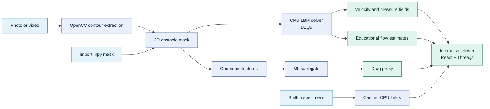
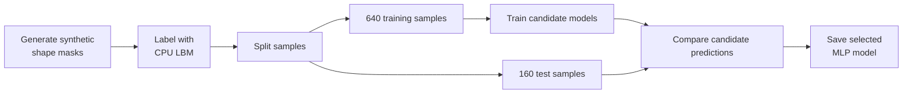

<div align="center">

# AeroVoxel

**An educational virtual wind tunnel, from image to airflow.**

Explore a built-in specimen or upload a picture, turn its outline into a grid,
and watch a CPU-computed flow field in your browser.

[Get started](#get-started) · [Try the tunnel](#try-the-tunnel) · [How it works](#how-it-works) · [Explore the ML model](#machine-learning-surrogate) · [Limitations](#limitations)


<sub>Illustrative landing artwork. See <a href="frontend/public/studio/CREDITS.md">visual asset credits</a>.</sub>

</div>

> **Educational prototype.** Live uploaded-image simulations use a coarse 2D CPU solver. The displayed force values are educational estimates, not validated engineering measurements.

## Explore the tunnel

<table>
<tr>
<td align="center" width="25%"><br><strong>NACA 0012</strong></td>
<td align="center" width="25%"><br><strong>Quadcopter</strong></td>
<td align="center" width="25%"><br><strong>Concept car</strong></td>
<td align="center" width="25%"><br><strong>Circular cylinder</strong></td>
</tr>
</table>

These specimens use saved CPU fields. Explore flow paths, pressure cues, speed maps, camera controls and educational metrics. An optional offline 3D sphere appears when its generated assets are available.

## What you can do

- **Upload a capture** — use an image or supported video to create a 2D obstacle mask with OpenCV.
- **Import a mask** — load a prepared `.npy` mask and inspect it before simulation.
- **Run a live simulation** — compute velocity and relative pressure around the mask with the CPU D2Q9 Lattice Boltzmann solver.
- **Explore the result** — switch views, pause the flow, inspect the speed map and adjust display layers.
- **Predict a drag proxy** — use the trained ML surrogate on shape features.
- **Present offline** — explore bundled specimen fields when the local backend is unavailable.

## Get started

### Prerequisites

- Python 3.10 or newer
- Node.js 20.19+ or 22.12+ and npm
- A desktop browser with WebGL support

Clone the repository and open two terminals in its root. The commands below use PowerShell on Windows.

### 1. Start the backend

```powershell
cd backend
python -m venv .venv
.\.venv\Scripts\Activate.ps1
python -m pip install -r requirements.txt
python -m uvicorn app.main:app --host 127.0.0.1 --port 8000
```

On macOS or Linux, activate the environment with `source .venv/bin/activate`. The backend health check is available at [127.0.0.1:8000/health](http://127.0.0.1:8000/health).

### 2. Start the frontend

In the second terminal:

```powershell
cd frontend
npm install
npm run dev
```

Open [127.0.0.1:5173](http://127.0.0.1:5173/). The frontend uses `http://127.0.0.1:8000` by default. To change it, copy `frontend/.env.example` to `frontend/.env` and update `VITE_API_URL`.

<details>
<summary><strong>PowerShell activation or connection trouble?</strong></summary>

- If PowerShell blocks activation, use the environment's Python directly: `.\.venv\Scripts\python.exe -m pip install -r requirements.txt`, then `.\.venv\Scripts\python.exe -m uvicorn app.main:app --host 127.0.0.1 --port 8000`.
- Keep both terminals running. Check the backend health URL and the frontend's `VITE_API_URL` if the app says **Offline demo**.
- The backend is required for a new upload, mask import, live solve and surrogate prediction. Bundled specimen fields remain available in offline demo mode.

</details>

## Try the tunnel

### Explore a specimen

1. Select **Explore the tunnel**, then choose an airfoil, quadcopter, car or cylinder.
2. Use the camera controls and **Display** menu to explore the scene.
3. Select **Speed map** for a 2D view of the loaded velocity field.

The source label **Cached CPU field** identifies a saved field.

### Run your own image

1. Confirm the top bar says **CPU solver online**.
2. Select **Upload capture** and choose a clear image with one object against a contrasting background.
3. Inspect the pink contour in **Your capture**. An incomplete contour produces an incomplete obstacle.
4. Select **Run 2D simulation** and wait for **Live 2D LBM field**.
5. Open **Speed map** or the results panel to inspect the result.

Immediately after upload, the viewer shows a closest cached template while the new mask is ready to run. The live field appears after the simulation. Video uploads use a selected frame, so they follow the same 2D silhouette workflow.

### Import an existing mask

Choose **Import mask**, select a valid `64 × 128` NumPy mask, inspect the preview and select **Run 2D simulation**. Example masks are in [backend/app/assets/flow](backend/app/assets/flow/), including `cylinder_v1_mask.npy`.

## How it works



OpenCV detects an external contour, fits it to the grid and fills the obstacle mask. The 2D solver uses a D2Q9 lattice and bounce-back boundaries to calculate an educational flow field. The live endpoint uses a `128 × 64` grid and 600 steps. The viewer renders the loaded data; its moving flow paths visualise a computed or cached field.

The frontend is built with React, TypeScript, Vite and Three.js. A FastAPI backend connects OpenCV, NumPy-based simulation and the scikit-learn surrogate.

<details>
<summary><strong>Optional depth reconstruction and 3D work</strong></summary>

The separate reconstruction workflow can use Depth Anything V2 Small to produce a depth-conditioned mesh and a centre-slice mask. The browser imports the resulting mask; **Upload capture** itself uses the OpenCV 2D path.

An optional SF3D adapter and an offline D3Q19 sphere workflow also exist. Their availability depends on runtimes, hardware and generated assets. Consult the [reconstruction setup and validation notes](backend/app/recon/README.md) for the current evidence and requirements.

</details>

## Machine learning surrogate

The surrogate estimates the project's `cd_force_proxy` from a mask. It does not produce the velocity or pressure field.



The saved experiment uses geometric features derived from the masks. Candidate models were compared against labels from the held-out portion.

The [saved evaluation](backend/app/ml/artifacts/last_eval.json) records **800 synthetic samples**, with **640 training** and **160 test** samples. The selected `mlp_geom` model uses geometric features and has a recorded MAE of approximately **0.123** against the held-out labels. Several candidate models were compared using that test set, so it is a model-selection result rather than an independent final evaluation. It measures agreement with this solver's labels, not real-world accuracy.

<details>
<summary><strong>View the prediction plot and regenerate the dataset</strong></summary>


The synthetic dataset is generated locally under gitignored `backend/data/ml_surrogate/`. From the backend directory, with the backend environment active:

```bash
python scripts/generate_ml_dataset.py --n 800 --seed 42
python scripts/train_surrogate.py --seed 42
python scripts/eval_surrogate.py
```

The trained bundle and evaluation snapshot are in [backend/app/ml/artifacts](backend/app/ml/artifacts/). Training and live simulation use different conditions and outputs; their displayed values should not be assumed to be directly interchangeable.

</details>

## Testing and reproducibility

<details>
<summary><strong>Run the backend tests</strong></summary>

From `backend/`, with its virtual environment active:

```bash
python -m pip install -r requirements-test.txt
python -m pytest -q tests
```

</details>

<details>
<summary><strong>Build and check the frontend</strong></summary>

From `frontend/`:

```bash
npm run build
npm run lint
npm run check:geometry
```

</details>

<details>
<summary><strong>Evaluation, data preparation and asset generation</strong></summary>

The following commands run from `backend/`. Generated evaluation outputs are gitignored.

```bash
python scripts/run_evaluation.py --live-2d --try-sphere-cache
python scripts/run_grid_study.py
python scripts/run_failure_tests.py
python scripts/run_phone_photo_tests.py
python -m app.services.cache_generator
python -m app.services.cache_generator_3d
```

Public Pix3D evaluation requires a separately obtained dataset. It is a public-data experiment, not a real phone-capture corpus:

```bash
python scripts/prepare_pix3d_manifest.py --pix3d-root /datasets/pix3d --output app/recon/recon_manifest.pix3d.csv --n 5
python scripts/evaluate_recon.py app/recon/recon_manifest.pix3d.csv --engine depth_anything --device cpu --output-dir ../evaluation_outputs/pix3d_depth_anything
```

See the [local verification record](docs/verification_2026-10-13.md), [AI metrics](docs/ai_metrics.md) and [reconstruction documentation](backend/app/recon/README.md) for scope and evidence. The reconstruction documentation covers optional dependencies and model downloads.

</details>

<details>
<summary><strong>API overview</strong></summary>

| Method | Endpoint | Purpose |
| --- | --- | --- |
| GET | `/health` | Backend health |
| GET | `/api/demo-cases` | Available specimen cases |
| GET | `/api/flow-field/{case_id}` | Flow metadata and array URLs |
| POST | `/api/upload` | Process an image or video |
| POST | `/api/simulate/simple` | Run the CPU 2D solver |
| GET | `/api/surrogate/status` | Check model availability |
| POST | `/api/surrogate/predict` | Predict the educational drag proxy |
| POST | `/api/recon/import` | Import a prepared mask |
| GET | `/api/recon/capability` | Check reconstruction capabilities |
| GET | `/api/recon/diagnostics` | Inspect runtime diagnostics |

Interactive API documentation is available at [127.0.0.1:8000/docs](http://127.0.0.1:8000/docs) while the backend is running.

</details>

## Limitations

- OpenCV can miss object boundaries, holes or disconnected parts, especially with cluttered or low-contrast images. Inspect the preview.
- A single image yields an approximate 2D silhouette for the live workflow. Its 3D-style presentation does not make the live solve 3D.
- Coarse grids and simplified boundary conditions limit the detail and physical fidelity of the flow.
- Drag and lift displays are educational estimates. The surrogate predicts a separate solver-derived proxy.
- Physical accuracy and generalisation to arbitrary real objects require further reference comparisons and validation.

## Project layout

```text
AeroVoxel/
├── backend/
│   ├── app/routes/       # FastAPI endpoints
│   ├── app/solvers/      # LBM implementations
│   ├── app/ml/           # Surrogate, features and saved artifacts
│   ├── app/recon/        # Optional reconstruction pipeline
│   ├── app/assets/flow/  # Bundled specimen fields and masks
│   ├── scripts/          # Training and evaluation
│   └── tests/
├── frontend/
│   ├── src/              # React interface and Three.js viewer
│   └── public/           # Models and visual assets
├── docs/
└── shared/
```

<details>
<summary><strong>Maintaining specimen geometry</strong></summary>

After changing display geometry, run `npm --prefix frontend run export:geometry`, then run `backend/scripts/regenerate_visual_demo_fields.py` with a fresh `--output-dir` in a configured Python environment. `npm --prefix frontend run check:geometry` checks the published projections. The car asset preparation script is `frontend/scripts/prepare-car-asset.py`.

</details>

## Credits and license

AeroVoxel is a portfolio and educational prototype. The existing project notice permits use and adaptation with attribution and asks that results are not presented as certified engineering analysis. Third-party assets carry their own terms; see the [car model attribution](frontend/public/models/ATTRIBUTION.md) and [visual asset credits](frontend/public/studio/CREDITS.md).
