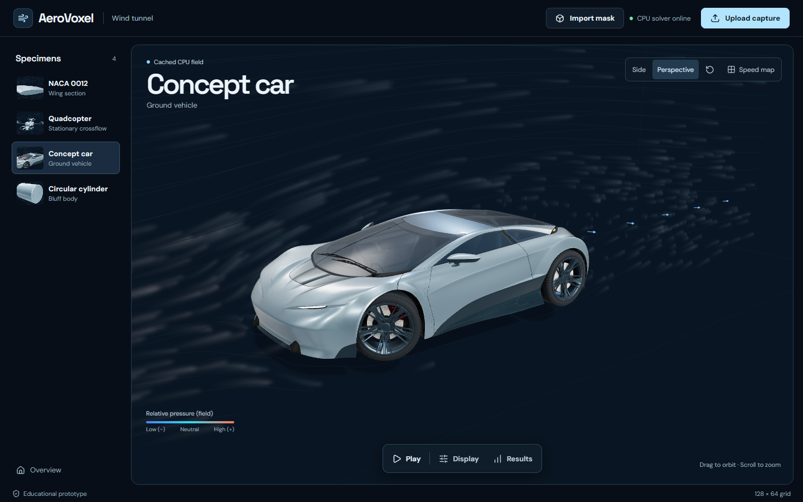
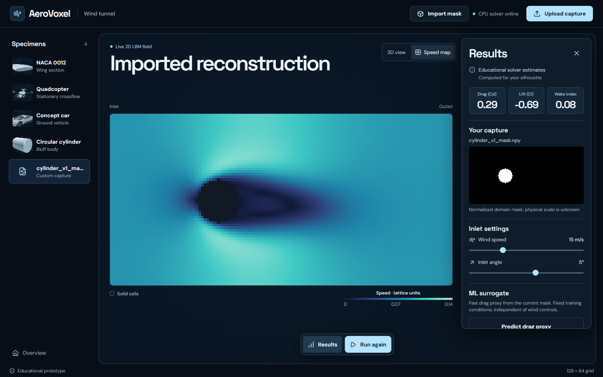
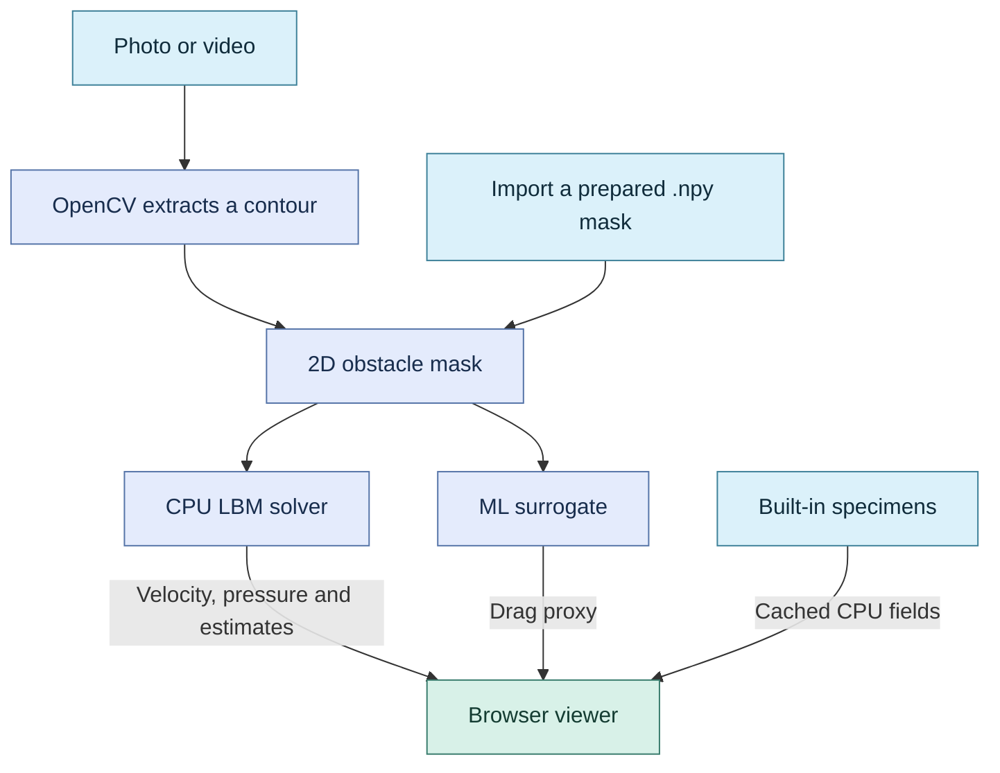
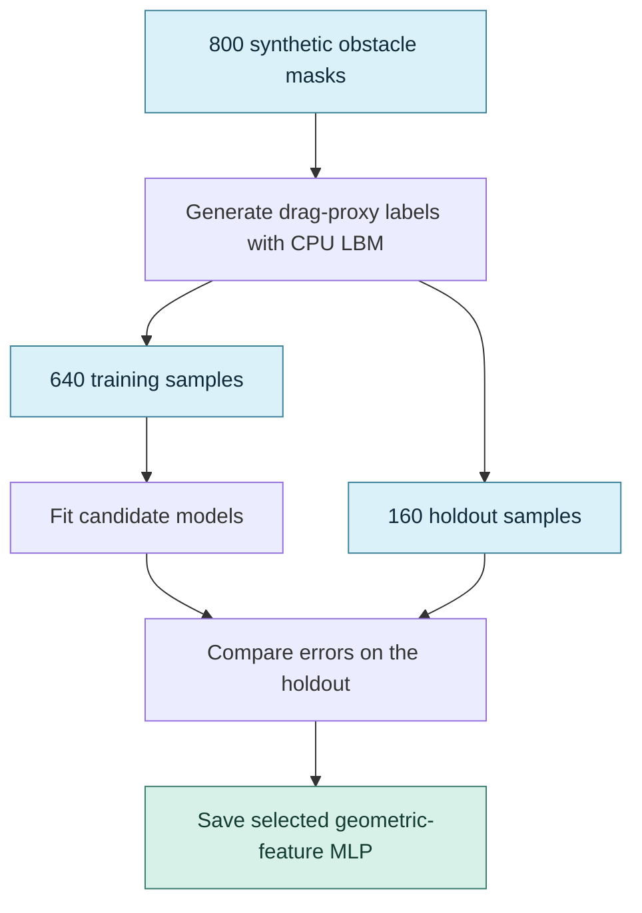
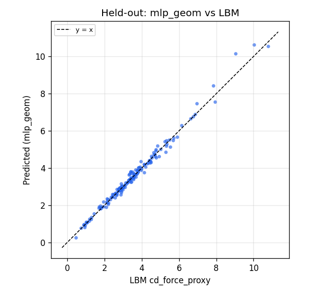

<div align="center">

<h1>AeroVoxel</h1>
<p><strong>Turn an image into an interactive airflow experiment.</strong></p>
<p>Explore four built-in specimens, upload a capture, or import your own obstacle mask.<br>Run a 2D airflow simulation locally on your CPU and inspect the result in the browser.</p>
<p>
  <a href="#quick-start"><strong>Quick start</strong></a> ·
  <a href="#try-a-live-simulation">Live demo</a> ·
  <a href="#how-it-works">Architecture</a> ·
  <a href="#machine-learning-surrogate">ML surrogate</a> ·
  <a href="#testing-and-reproducibility">Testing</a>
</p>
<p><code>Python</code> · <code>OpenCV</code> · <code>FastAPI</code> · <code>React</code> · <code>Three.js</code></p>

<p><sub>Concept car in the wind tunnel, displaying a cached CPU flow field.</sub></p>

</div>

> [!NOTE]
> AeroVoxel is an educational prototype. The live solver computes approximate 2D airflow, and the displayed forces are educational estimates.

## Explore the wind tunnel

<table>
  <tr>
    <td width="25%" align="center"><br><strong>NACA 0012</strong><br><sub>Airfoil</sub></td>
    <td width="25%" align="center"><br><strong>Quadcopter</strong><br><sub>Stationary crossflow</sub></td>
    <td width="25%" align="center"><br><strong>Concept car</strong><br><sub>Ground vehicle</sub></td>
    <td width="25%" align="center"><br><strong>Circular cylinder</strong><br><sub>Bluff body</sub></td>
  </tr>
</table>

| Start with | What AeroVoxel does |
| --- | --- |
| **A built-in specimen** | Loads its saved CPU field. Orbit the camera, pause the flow paths, or switch to **Speed map**. The four bundled specimens also work in **Offline demo** mode. |
| **Your own photo or video** | Uses OpenCV to extract a contour and build a 2D mask. A video is processed from a selected frame. |
| **A prepared NumPy mask** | Validates and previews the obstacle. Run the CPU solver or request a drag proxy from the trained model. |

An offline 3D sphere can appear when its generated assets are available.

## Quick start

Use **Python 3.10+**, **Node.js 22.13+ in the 22.x series or Node.js 24**, npm, and a desktop browser with WebGL. Run the backend and frontend in separate terminals from the repository root.

### Start the backend

```powershell
cd backend
python -m venv .venv
.\.venv\Scripts\Activate.ps1
python -m pip install -r requirements.txt
python -m uvicorn app.main:app --host 127.0.0.1 --port 8000
```

On macOS or Linux, activate the environment with `source .venv/bin/activate`. Check that the backend is running at [127.0.0.1:8000/health](http://127.0.0.1:8000/health).

### Start the frontend

```powershell
cd frontend
npm install
npm run dev
```

Open **[127.0.0.1:5173](http://127.0.0.1:5173/)**, then select **Explore the tunnel**.

<details>
<summary><strong>Environment setup and troubleshooting</strong></summary>

- If PowerShell blocks activation, run `.\.venv\Scripts\python.exe` in place of `python` in the backend install and launch commands.
- The browser connects to `http://127.0.0.1:8000` by default. To change the API address, copy [`frontend/.env.example`](frontend/.env.example) to `frontend/.env` and set `VITE_API_URL`.
- If the app shows **Offline demo**, check the backend health endpoint and keep both terminals running. New uploads, mask imports, live solves and surrogate predictions use the local backend.

</details>

## Try a live simulation

1. Check that the top bar says **CPU solver online**.
2. Choose **Upload capture** and select a photo of a single object on a contrasting background. Inspect the pink contour in **Your capture**. The viewer shows the closest cached specimen until you run the solver.
3. Click **Run 2D simulation** and wait for **Live 2D LBM field**. That label identifies the newly computed field for your mask.
4. Open **Speed map** to inspect the velocity field or **Results** to see the solver’s educational estimates.

To demonstrate **Import mask**, select [`cylinder_v1_mask.npy`](backend/app/assets/flow/cylinder_v1_mask.npy), inspect its preview and run the solver. Imports use a binary grid with 64 rows and 128 columns.

<div align="center">
  
  <p><sub>The speed map displays a live 2D field computed around an imported cylinder mask.</sub></p>
</div>

## How it works



| Layer | Technology and role |
| --- | --- |
| **Capture and mask preparation** | OpenCV extracts an external contour, fills the mask and checks for an optional scale card. |
| **Simulation** | NumPy implements a D2Q9 lattice Boltzmann method (LBM) with bounce-back boundaries. The live endpoint uses a 128 × 64 grid and 600 steps. |
| **Backend** | FastAPI handles uploads, mask validation, solver requests and model inference. |
| **Browser** | React, TypeScript and Vite run the interface. Three.js animates the loaded flow field. |

<details>
<summary><strong>Optional depth reconstruction and 3D workflows</strong></summary>

The separate Depth Anything V2 Small pipeline can produce a depth-conditioned mesh and a centre-slice mask. Import the exported mask through **Import mask**. **Upload capture** uses OpenCV for direct 2D processing.

The project also includes an SF3D adapter and an offline D3Q19 sphere workflow. Availability depends on installed runtimes, hardware and generated assets. See the [reconstruction documentation](backend/app/recon/README.md).

</details>

## Machine learning surrogate

The saved scikit-learn MLP uses geometric features from the obstacle mask to predict `cd_force_proxy`. The live solver provides the velocity and pressure fields.



| Saved experiment | Result |
| --- | --- |
| Selected model | `mlp_geom` |
| Holdout MAE | **0.123** against the project’s LBM labels |
| Evaluation scope | The holdout was used to select the model. The recorded error measures agreement with synthetic solver labels. |

[Saved evaluation](backend/app/ml/artifacts/last_eval.json) · [AI metrics and baselines](docs/ai_metrics.md)

<details>
<summary><strong>View the prediction plot</strong></summary>



Each point is one synthetic mask from the holdout. Points near the dashed line show closer agreement with the solver's drag-proxy label.

</details>

<details>
<summary><strong>Regenerate the dataset and train the surrogate</strong></summary>

Run from `backend/` with its virtual environment active. Generated data goes under the gitignored `backend/data/ml_surrogate/` path.

```bash
python scripts/generate_ml_dataset.py --n 800 --seed 42
python scripts/train_surrogate.py --seed 42
python scripts/eval_surrogate.py
```

The [trained bundle and evaluation snapshot](backend/app/ml/artifacts/) are saved in the repository. The surrogate and live simulation use different run conditions and output measures.

</details>

## Limitations

- **The contour controls the result.** Clutter, low contrast, holes and disconnected parts can yield incomplete masks. Inspect the preview before running a simulation.
- **The live solver uses a 2D grid.** The perspective camera gives another view of the same field. Grid resolution and simplified boundaries limit the flow detail.
- **The metrics are educational.** Physical accuracy and generalisation to arbitrary real objects require validation against external reference measurements.

## Testing and reproducibility

[Local verification](docs/verification_2026-10-13.md) · [CPU photo evaluation](docs/web_photo_cpu_2026-10-13.md) · [Reconstruction notes](backend/app/recon/README.md)

<details>
<summary><strong>Backend tests and frontend checks</strong></summary>

From `backend/`, with the virtual environment active:

```bash
python -m pip install -r requirements-test.txt
python -m pytest -q tests
```

From `frontend/`:

```bash
npm run build
npm run lint
npm run check:geometry
```

</details>

<details>
<summary><strong>Evaluation and asset generation</strong></summary>

Run from `backend/`. Generated evaluation outputs are gitignored.

```bash
python scripts/run_evaluation.py --live-2d --try-sphere-cache
python scripts/run_grid_study.py
python scripts/run_failure_tests.py
python scripts/run_phone_photo_tests.py
python -m app.services.cache_generator
python -m app.services.cache_generator_3d
```

Pix3D evaluation uses separately obtained public dataset images. See the [reconstruction documentation](backend/app/recon/README.md) for dependencies and model availability.

```bash
python scripts/prepare_pix3d_manifest.py --pix3d-root /datasets/pix3d --output app/recon/recon_manifest.pix3d.csv --n 5
python scripts/evaluate_recon.py app/recon/recon_manifest.pix3d.csv --engine depth_anything --device cpu --output-dir ../evaluation_outputs/pix3d_depth_anything
```

For changes to specimen geometry, run `npm --prefix frontend run export:geometry` from the root, then use `backend/scripts/regenerate_visual_demo_fields.py` with a fresh `--output-dir` in the configured backend environment. `npm --prefix frontend run check:geometry` checks the published projections. The car preparation script is `frontend/scripts/prepare-car-asset.py`.

</details>

<details>
<summary><strong>API and repository map</strong></summary>

| Endpoint | Purpose |
| --- | --- |
| `GET /health` | Backend health |
| `GET /api/demo-cases` | Available specimens |
| `GET /api/flow-field/{case_id}` | Field metadata and arrays |
| `POST /api/upload` | Process a photo or video |
| `POST /api/recon/import` | Import a prepared mask |
| `GET /api/recon/capability` | Check reconstruction capability |
| `GET /api/recon/diagnostics` | Inspect runtime diagnostics |
| `POST /api/simulate/simple` | Run the CPU solver |
| `GET /api/surrogate/status` | Check model availability |
| `POST /api/surrogate/predict` | Predict the drag proxy |

Open [127.0.0.1:8000/docs](http://127.0.0.1:8000/docs) for the interactive API reference while the backend is running.

```text
backend/app/routes/       FastAPI endpoints
backend/app/solvers/      LBM implementations
backend/app/ml/           Surrogate and saved artifacts
backend/app/recon/        Optional depth reconstruction
backend/app/assets/flow/  Specimen fields and example masks
backend/scripts/          Training and evaluation
backend/tests/            Backend tests
frontend/src/             Browser interface and viewer
frontend/public/          Models and visual assets
docs/                     Evaluation and verification notes
shared/                   Shared project assets
```

</details>

## Credits and license

AeroVoxel is an educational and portfolio prototype. The project notice permits use and adaptation with attribution and asks users to present results as educational estimates. Third-party assets carry their own terms. [Car model attribution](frontend/public/models/ATTRIBUTION.md) · [Visual asset credits](frontend/public/studio/CREDITS.md)
